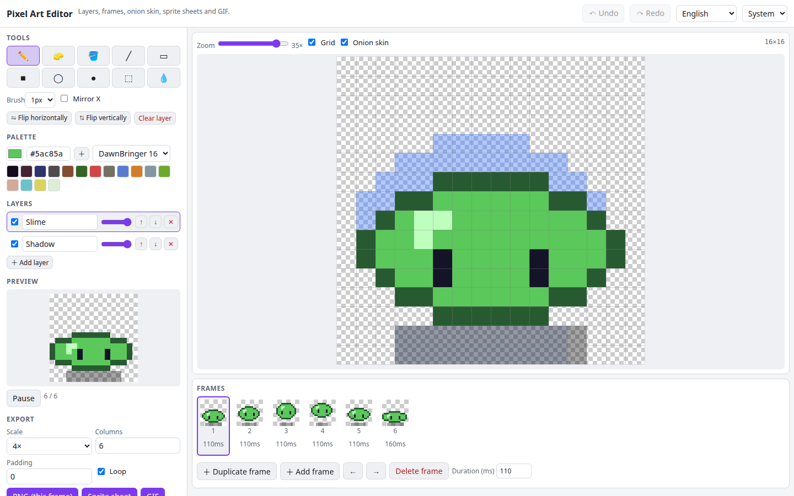

# Pixel Art Editor

A pixel art editor that runs in your browser. Draw with pencil, fill, line, rectangle, ellipse and selection tools, use ready-made palettes, stack layers, animate with frames and onion skin, and export PNG, sprite sheets (with JSON metadata) and animated GIFs.

**Try it: [hermes98761234.github.io/pixel-art-editor](https://hermes98761234.github.io/pixel-art-editor/)**

[](https://github.com/hermes98761234/pixel-art-editor/actions/workflows/deploy.yml)



## Features

- **Tools:** pencil and eraser (1-4 px brush, mirror X), flood fill, line, rectangle and ellipse (outline or filled), rectangular selection with move, copy, cut, paste and delete, colour picker. Keyboard shortcuts (B E G L R O M I, Ctrl+Z/Y/C/X/V).
- **Palettes:** PICO-8, DawnBringer 16, Sweetie 16, Game Boy, 1-bit, plus your own colours.
- **Layers** with visibility, opacity and reordering. **Frames** with per-frame duration, duplicate, reorder, and **onion skin** (previous in red, next in blue).
- **Animation preview** that plays at the real frame timings.
- **Export:** PNG at 1-16x, sprite sheet PNG with TexturePacker-style JSON, animated GIF (own encoder, transparency supported), and a project file. Opens project files and PNG/JPEG images.
- Autosaves in the browser. English and Ukrainian, light/dark/system theme. Nothing is uploaded.

## How it works

Each cel is a `Uint32Array` of packed RGBA pixels. Edits are immutable updates, so undo/redo is a stack of sprite snapshots that share unchanged cels. Frames are composited with straight-alpha "over" blending using per-layer opacity. The GIF writer builds a palette (exact up to 255 colours, popularity plus nearest-colour beyond that), then does variable-width LZW; the unit tests decode the output with a reference LZW decoder.

## Quick start

You need [Node.js](https://nodejs.org/) 22.

```bash
git clone https://github.com/hermes98761234/pixel-art-editor.git
cd pixel-art-editor
npm install
npm run dev       # http://localhost:5173
npm test
npm run build     # static site in dist/
```

## License

MIT
